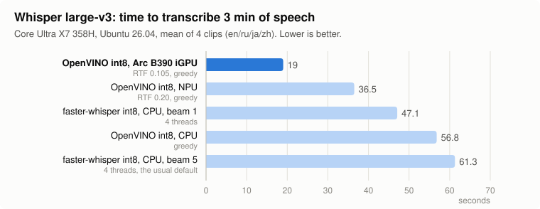
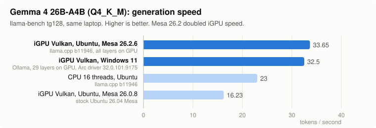
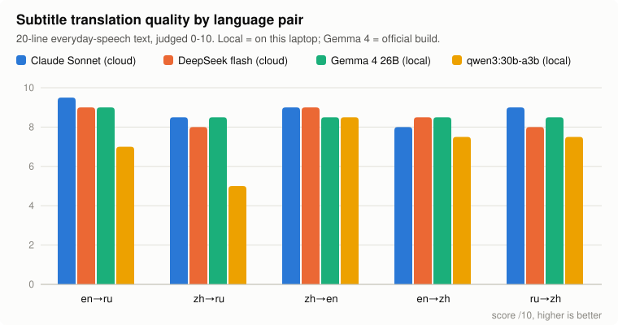

# Local AI on Intel Arc B390 (Panther Lake): Whisper, Qwen3-ASR, Gemma 4 and Qwen3 benchmarks on iGPU, NPU and CPU

**English** · [Русский](README.ru.md)

Measured speed and accuracy of local speech recognition (ASR) and LLM translation on a thin laptop with an **Intel Core Ultra X7 358H** (Panther Lake) and its **Intel Arc B390** integrated GPU, 32 GB RAM, no discrete GPU. Runtimes: **OpenVINO GenAI**, **llama.cpp (Vulkan)**, **Ollama**, **faster-whisper**. OS: **Ubuntu 26.04** with Mesa 26.0.8 and 26.2.6, plus **Windows 11** for comparison. Cloud ASR and translation APIs are included as a reference.

The numbers come from building a batch tool that turns foreign-language video into translated subtitles (ja/zh/en/ru). Tests ran from October 27 to November 19, 2026.

## Key results

| Finding | Number |
|---|---|
| Whisper large-v3 on the Arc B390 iGPU (OpenVINO int8) vs faster-whisper on the CPU | **3.2× faster**: 19 s vs 61 s per 3 min of audio (RTF 0.105 vs 0.34) |
| Whisper large-v3 on the NPU (OpenVINO) | works, same text, **half the iGPU speed** (RTF 0.20), uses 15 % of one CPU core, needs ~7.5 GB RAM, first compile 15 min |
| Qwen3-ASR 1.7B on the iGPU (llama.cpp Vulkan) | **1.6× faster** than CPU, identical text |
| Gemma 4 26B-A4B generation on the iGPU, **Mesa 26.0.8 → 26.2.6** | **16.2 → 33.7 tok/s (2.1×)**; now 1.6× faster than the CPU (20.7–23 tok/s) |
| Subtitle translation with Gemma 4 26B through Ollama, iGPU vs CPU | **0.48 s/line vs 2.2 s/line** (103 lines, ja→ru) |
| Windows 11 vs Ubuntu, same laptop | Whisper on the iGPU and LLM on the CPU are the same; LLM on the iGPU was 2× faster on Windows **until Mesa 26.2**, now the same tok/s (Ubuntu 10–20 % faster per line because all layers fit on the GPU) |
| Best local translation model (5 language pairs) | **Gemma 4 26B-A4B**: official build 8.6/10 on average at 0.74 s/line on the iGPU, close to Claude Sonnet (8–9.5) and DeepSeek (8–9) |
| Official Gemma 4 vs a community "abliterated" build | official is as good or better (8.6 vs 8.3) and ~9 % faster per line; no refusals from either on everyday text |
| Best local ASR per language | ja: Whisper large-v3 · zh, en: Qwen3-ASR 1.7B · ru: GigaAM v3 (noisy) / Whisper large-v3 (clean) |

## Contents

- [Test machine and software](#test-machine-and-software)
- [1. Speech recognition on iGPU, NPU and CPU](#1-speech-recognition-on-igpu-npu-and-cpu)
- [2. LLM on the Arc B390 iGPU: update Mesa](#2-llm-on-the-arc-b390-igpu-update-mesa)
- [3. Windows 11 vs Ubuntu 26.04](#3-windows-11-vs-ubuntu-2604)
- [4. Running ASR and LLM at the same time](#4-running-asr-and-llm-at-the-same-time)
- [5. ASR accuracy: local vs cloud, by language](#5-asr-accuracy-local-vs-cloud-by-language)
- [6. Translation quality by language pair](#6-translation-quality-by-language-pair)
- [How to reproduce](#how-to-reproduce)
- [Method and caveats](#method-and-caveats)
- [Data files](#data-files)

## Test machine and software

| | |
|---|---|
| Laptop | Lenovo ThinkBook 16+ G8+ (2026) |
| CPU | Intel Core Ultra X7 358H (Panther Lake), 16 cores |
| iGPU | Intel Arc B390 (Xe3), shares system RAM |
| NPU | Intel AI Boost |
| RAM | 32 GB (Vulkan can allocate up to ~23 GB to the iGPU, OpenVINO up to ~28 GB) |
| Linux | Ubuntu 26.04, kernel 7.0, Mesa 26.0.8 (stock) and 26.2.6 (kisak PPA), Intel NPU driver 1.38.0 |
| Windows | Windows 11, Arc driver 32.0.101.9175 |
| Runtimes | OpenVINO / OpenVINO GenAI 2026.4.1, llama.cpp b11946 (CPU and Vulkan builds), Ollama, faster-whisper (CTranslate2 int8) |
| Power | always on AC; power profile "performance" unless noted |

## 1. Speech recognition on iGPU, NPU and CPU

Four 3-minute clips (en, ru, ja, zh) from public TEDx/TED talks. Time is the mean per clip.

<picture>
  <source media="(prefers-color-scheme: dark)" srcset="charts/whisper-devices-dark.svg">
  
</picture>

| Model | Runtime | Device | Time per 180 s | RTF | Speed-up |
|---|---|---|---:|---:|---:|
| Whisper large-v3 int8, beam 5 | faster-whisper | CPU, 4 threads | 61.3 s | 0.34 | 1× |
| Whisper large-v3 int8, beam 1 | faster-whisper | CPU, 4 threads | 47.1 s | 0.26 | 1.3× |
| Whisper large-v3 int8 | OpenVINO GenAI | CPU | 56.8 s | 0.32 | 1.1× |
| **Whisper large-v3 int8** | **OpenVINO GenAI** | **Arc B390 iGPU** | **19.0 s** | **0.105** | **3.2×** |
| Whisper large-v3 int8 | OpenVINO GenAI | NPU | 36.5 s | 0.20 | 1.7× |
| Qwen3-ASR 1.7B Q8_0 | llama.cpp | CPU, 8 threads | 53.3 s | 0.30 | — |
| **Qwen3-ASR 1.7B Q8_0** | **llama.cpp Vulkan** | **Arc B390 iGPU** | **33.4 s** | **0.185** | **1.6× vs its CPU run** |

- Accuracy does not change on the iGPU: OpenVINO GPU and CPU give the same text. OpenVINO Whisper only does greedy decoding (beam search on the iGPU is still broken in OpenVINO GenAI 2026.4), which costs about 2 points of WER on English (8.0 vs 5.7) and nothing on Russian or Japanese.
- On a hybrid CPU, more threads made faster-whisper slower: 4 threads (the CTranslate2 default) beat 16 threads by 1.3–2.8×. Qwen3-ASR was best at 8 threads.
- GigaAM v3 (Russian) already runs at RTF 0.05–0.18 on the CPU and does not need the iGPU.
- After the Mesa 26.2.6 update (section 2), Whisper on the iGPU got ~7 % faster and Qwen3-ASR on Vulkan ~30 % faster, with identical text.

### NPU vs iGPU (Whisper large-v3, OpenVINO, 180 s clips)

| | NPU | iGPU |
|---|---:|---:|
| Time per clip | 35–39 s (RTF 0.20) | 18–21 s (RTF 0.10) |
| CPU load | 15–17 % of one core | ~100 % of one core |
| System RAM used | ~7.5 GB | ~3.5 GB |
| Package power | ~19.5 W | ~29 W |
| Energy per clip, above idle | 380–410 J | 370–430 J |
| First load | 910 s compile, 10.3 GB peak (then ~4 s from cache) | 4.4 s |
| Accuracy | same text (ru/en identical, ja/zh differ by a few characters) | |

The NPU is quieter and leaves the CPU and iGPU free, but it is twice as slow, uses twice the RAM and saves no energy per clip. On AC power the iGPU is the better choice. Qwen3-ASR, GigaAM and the 26–30B LLMs do not run on the NPU.

## 2. LLM on the Arc B390 iGPU: update Mesa

With the stock Ubuntu 26.04 Mesa (26.0.8), the iGPU processed prompts 6× faster than the CPU but generated tokens 30 % slower. Mesa 26.2.6 fixed this: generation doubled.

<picture>
  <source media="(prefers-color-scheme: dark)" srcset="charts/gemma-mesa-dark.svg">
  
</picture>

llama-bench (llama.cpp b11946), Q4_K_M GGUF files, all layers on the iGPU (`-ngl 99 -fa 1`):

| Model | Backend | Mesa | Prompt pp512, tok/s | Generation tg128, tok/s |
|---|---|---|---:|---:|
| Gemma 4 26B-A4B QAT | CPU, 16 threads | — | 103.6–108.9 | 20.7–23.0 |
| Gemma 4 26B-A4B QAT | Vulkan iGPU | 26.0.8 | 687.8 | 16.2 |
| **Gemma 4 26B-A4B QAT** | **Vulkan iGPU** | **26.2.6** | **743.9** | **33.7** |
| Gemma 4 26B-A4B QAT | Vulkan, weights on CPU (`-ngl 0`) | 26.0.8 | 195.4 | 16.5 |
| Qwen3 30B-A3B | CPU, 16 threads | — | 113.8 | 27.8 |
| Qwen3 30B-A3B | Vulkan iGPU | 26.0.8 | 687.9 | 22.6 |

End to end, translating a 103-line subtitle file (ja→ru) with Gemma 4 26B through Ollama, batches of 25 lines:

| Where Gemma runs | Time | Per line |
|---|---:|---:|
| **iGPU** (Ollama with Vulkan, Mesa 26.2.6, 31/31 layers on GPU) | **49 s** | **0.48 s** |
| CPU (Ollama, 16 threads) | 228 s | 2.2 s (2 of 5 batches had to be retried; ~1.3 s/line in clean runs) |

Notes:
- Ollama uses the Intel iGPU only with `OLLAMA_VULKAN=1` and `OLLAMA_IGPU_ENABLE=1`.
- Splitting layers ("weights on CPU, prompt on GPU") was worse than either pure mode.
- The llama.cpp OpenVINO backend ran out of memory while loading a 16 GB model and is not usable for 26B models on 32 GB.
- The iGPU has no own memory. One 16–18 GB LLM plus one ASR model (2–3 GB) fit together; two large LLMs do not.
- After Ollama unloaded Gemma from the iGPU, 11–16 GB of RAM stayed held outside any process (most likely the xe driver's pool). Restarting Ollama did not free it; `sync && echo 3 | sudo tee /proc/sys/vm/drop_caches` did. While it was held, Vulkan saw only ~10 GB and the next model loaded 20 % on CPU, 80 % on GPU, which is slower.

## 3. Windows 11 vs Ubuntu 26.04

Same laptop, dual boot, the same 5.5-minute Japanese video, AC power.

| Test | Windows 11 | Ubuntu 26.04 | Result |
|---|---:|---:|---|
| Whisper large-v3 int8, OpenVINO, iGPU | 12.8× realtime (9.6× with word timestamps) | ~9.5× realtime (with word timestamps) | same |
| faster-whisper large-v3 int8, beam 5, CPU 16 threads | 1.08 min per audio minute | 0.66 min per audio minute | Ubuntu 1.6× faster (Windows was on the Balanced plan) |
| Gemma 4 26B, Ollama, CPU, generation | 21.8 tok/s | 23.0 tok/s | same |
| Gemma 4 26B, iGPU Vulkan, generation | 32.5 tok/s (Ollama, 29 layers on GPU; full offload ran out of memory) | 16.2 tok/s with Mesa 26.0.8 → **33.7 tok/s with Mesa 26.2.6** | was 2× in favour of Windows, now equal |

The only gap between the two systems was the Linux Vulkan driver, and a newer Mesa closes it.

Re-check on 2026-11-20 with both Gemma 4 builds, the same 20-line requests (section 6), Ollama with Vulkan:

| Gemma 4 26B-A4B | Ubuntu, s/line | Windows, s/line | Ubuntu, tok/s | Windows, tok/s |
|---|---:|---:|---:|---:|
| official (`gemma4:26b`) | 0.74 | 0.91 (0.82 without the first request) | 32.4 | 32.2 |
| abliterated build | 0.81 | 0.97 (0.90 without the first request) | 30.7 | 29.3 |

- Ubuntu: Ollama 0.40.11, Mesa 26.2.6, 31 of 31 layers on the GPU. Windows: Ollama 0.40.16, 30 of 31 layers on the GPU (all 31 did not fit the 18 GB Vulkan heap).
- Generation speed is now equal. Windows is 10–20 % slower per line because one layer stays on the CPU and the first request after loading takes 29–37 s instead of ~16 s. Run-to-run noise on Windows (0.84–0.97 s/line for the same model) is bigger than the gap between the two models.
- On Windows with Vulkan, the official model (it carries an extra 0.45 GB MTP draft model) would not load at any `num_gpu` until `LLAMA_ARG_NO_HOST=1` was set for `ollama serve`. Without it, the CPU part of the weights goes to Vulkan host memory and counts against the 18 GB heap.

## 4. Running ASR and LLM at the same time

CPU, iGPU and NPU share one memory bus and one power budget. Measured pairs (Mesa 26.0.8):

| Running together | ASR | LLM (Gemma 4 26B) prompt / generation |
|---|---|---|
| Whisper OpenVINO on iGPU + Gemma on CPU (12 threads) | 20.9 s instead of 19.0 (−10 %) | 80 / 14.6 tok/s instead of 109 / 23.0 (−27 % / −37 %) |
| Gemma on iGPU + faster-whisper on CPU (4 threads) | 62.7 s instead of 59.6 (−5 %) | 628 / 14.4 tok/s instead of 688 / 16.2 (−9 % / −11 %) |

An LLM on the CPU suffers most from a neighbour. If you pipeline video N's translation with video N+1's recognition, keep the LLM on the iGPU.

## 5. ASR accuracy: local vs cloud, by language

Error rate in % (CER for Japanese and Chinese, WER for Russian and English). Lower is better.
Columns: **FLEURS** (read speech, ~10 min per language), **talk** (3 min of a TEDx talk with human subtitles), **interview** (3 min of a 2-speaker conversation), **noise** (3 min of a TV talk show with music and laughter). RTF for local models is on the CPU.

### Japanese (CER %)

| Model | Type | FLEURS | Talk | RTF |
|---|---|---:|---:|---:|
| ElevenLabs Scribe v2 | cloud | **4.0** | 5.2 | 0.09 |
| gpt-4o-mini-transcribe | cloud | 5.2 | **4.7** | 0.06 |
| gpt-4o-transcribe | cloud | 4.9 | 5.4 | 0.08 |
| Gemini 3.5 Transcribe | cloud | 4.3 | 5.4 | 1.07 |
| whisper-1 | cloud | 7.8 | 5.1 | 0.19 |
| **Whisper large-v3** | local | 6.4 | 5.9 | 0.88 |
| Qwen3-ASR 1.7B | local | 7.4 | 6.6 | 0.38 |
| Qwen3-ASR 0.6B | local | 11.6 | 6.3 | 0.23 |

### Chinese (CER %)

| Model | Type | FLEURS | Talk | Interview* | RTF |
|---|---|---:|---:|---:|---:|
| ElevenLabs Scribe v2 | cloud | 4.0 | 8.6 | **1.7*** | 0.09 |
| Gemini 3.5 Transcribe | cloud | **3.2** | 7.9 | 4.1 | 0.11 |
| gpt-4o-mini-transcribe | cloud | 4.0 | **7.0** | 6.5 | 0.06 |
| gpt-4o-transcribe | cloud | 3.9 | 7.5 | 6.5 | 0.09 |
| whisper-1 | cloud | 4.2 | 8.8 | 8.4 | 0.14 |
| **Qwen3-ASR 1.7B** | local | 3.4 | 10.8 | 2.7 | 0.36 |
| SenseVoice Small | local | 5.3 | 10.7 | 3.4 | **0.06** |
| FireRedASR2-AED | local | 5.2 | 12.0 | 4.1 | 0.92 |
| Whisper large-v3 | local | 5.0 | 9.1 | 8.0 | 0.92 |

### Russian (WER %)

| Model | Type | FLEURS | Talk | Interview | Noise* | RTF |
|---|---|---:|---:|---:|---:|---:|
| gpt-4o-transcribe | cloud | **2.9** | **2.7** | **11.8** | 27.4 | 0.09 |
| gpt-4o-mini-transcribe | cloud | 4.5 | 3.7 | 13.6 | 21.7 | 0.07 |
| whisper-1 | cloud | 5.3 | 2.7 | 14.6 | 21.0 | 0.13 |
| ElevenLabs Scribe v2 | cloud | 3.8 | 5.6 | 16.9 | 0.0* | 0.09 |
| Gemini 3.5 Transcribe | cloud | – | 4.8 | 17.4 | 19.7 | 0.04 |
| **GigaAM v3 e2e-RNNT** | local | 6.5 | 5.1 | 20.2 | **13.3** | 0.18 |
| **Whisper large-v3** | local | 5.5 | 2.7 | 17.2 | 17.9 | 1.12 |
| Qwen3-ASR 1.7B | local | 6.5 | 6.4 | 14.8 | 17.9 | 0.48 |
| Parakeet TDT 0.6B v3 | local | 9.3 | 9.3 | 22.6 | 28.1 | 0.22 |

gpt-4o-transcribe is the most accurate on clean Russian but drops about a fifth of the text on noisy audio.

### English (WER %)

| Model | Type | FLEURS | Talk | Interview | RTF |
|---|---|---:|---:|---:|---:|
| gpt-4o-mini-transcribe | cloud | **5.8** | 5.3 | **6.2** | 0.08 |
| whisper-1 | cloud | 6.9 | **4.9** | 7.6 | 0.14 |
| gpt-4o-transcribe | cloud | 6.6 | 5.1 | 8.8 | 0.09 |
| Gemini 3.5 Transcribe | cloud | – | 5.8 | 9.2 | 0.03 |
| ElevenLabs Scribe v2 | cloud | 6.0 | 6.4 | 10.2 | 0.11 |
| **Qwen3-ASR 1.7B** | local | 5.9 | 5.6 | 8.8 | 0.40 |
| Whisper large-v3 | local | 8.1 | 5.1 | 9.3 | 1.32 |
| Parakeet TDT 0.6B v3 | local | 12.1 | 8.3 | 18.0 | 0.25 |

\* "Interview" for Chinese and "noise" for Russian have no human subtitles. Their reference was built from Scribe v2's text and corrected where other models disagreed, so Scribe looks better there than it is.

Heads-up: OpenAI announced that gpt-4o-transcribe, gpt-4o-mini-transcribe and whisper-1 shut down on 2027-02-26.

## 6. Translation quality by language pair

A 20-line everyday-speech text (a travel vlog with names, food and slang; [source](test-texts/travel_vlog_en.md)), translated line by line as subtitles in batches. Each output was scored 0–10 against a reference for meaning, names, person/gender, tone, and for Chinese targets also Simplified characters and full-width punctuation.

<picture>
  <source media="(prefers-color-scheme: dark)" srcset="charts/translation-quality-dark.svg">
  
</picture>

| Model | Type | en→ru | zh→ru | zh→en | en→zh | ru→zh | s/line |
|---|---|---:|---:|---:|---:|---:|---:|
| Claude Sonnet (via claude CLI) | cloud | **9.5** | **8.5** | **9** | 8 | **9** | 0.5 |
| DeepSeek deepseek-flash | cloud | 9 | 8 | **9** | **8.5** | 8 | **0.4** |
| DeepSeek deepseek-v4-pro | cloud | 9 | 8 | 8.5 | 8 | 8 | 1.2 |
| **Gemma 4 26B-A4B, official** (`gemma4:26b`) ² | local | 9 | **8.5** | 8.5 | **8.5** | 8.5 | 0.74 (iGPU) |
| Gemma 4 26B-A4B QAT, abliterated build ¹ | local | 9 | 8 | 8.5 | 8 | 8.5 | 8.1 (CPU) / 0.81 (iGPU) |
| Qwen3.5 35B-A3B ¹ | local | 8.5 | 7.5 | 8 | 8 | 7.5 | 5.4 |
| qwen3:30b-a3b | local | 7 | 5 | 8.5 | 7.5 | 7.5 | 5.1 |
| Qwen3 30B-A3B instruct-2507 ¹ | local | 6.5 | 5 | 8 | 7 | 7.5 | 5.4 |
| qwen3:14b | local | 5.5 | 4 | 8 | 8 | 7.5 | 18.4 |
| Hunyuan-MT 1.5 7B ¹ | local | – | 6 | 7.5 | 7 | 6.5 | 26.8 |

¹ Community "abliterated" builds from Ollama (`huihui_ai/...`): models with the refusal mechanism removed. Local speed is Ollama on the CPU, 16 threads; the iGPU numbers are Ollama with Vulkan and Mesa 26.2.6.
² Scored in a separate run on 2026-11-20 (see below).

What we saw:
- **Gemma 4 26B-A4B is the best local model in every pair** and is close to the cloud models. The official build is at least as good as the abliterated one. Qwen3 30B and Hunyuan-MT are weak at Chinese→Russian (≈5–6): wrong names, Chinese characters leaking into Russian text, "hotpot" translated literally.
- DeepSeek flash costs almost nothing (both DeepSeek models together cost about $0.01 for the whole test) and is as good as Sonnet here.
- Typical errors across all models: names (Anya → 阿尼亚/安娜 instead of 安雅), wrong gender of the speaker in Russian, half-width punctuation in Chinese.
- Hunyuan-MT 7B could not keep the JSON batch format, so batches fell back to single lines (27 s/line).

### Official Gemma 4 vs the abliterated build

Same 20-line text, both models Q4_K_M, all layers on the iGPU (Ubuntu, Mesa 26.2.6, Ollama 0.40.11), one pass each at temperature 0.2:

| Pair | Abliterated | Official `gemma4:26b` | s/line, abliterated / official | Refusals |
|---|---:|---:|---:|---:|
| en→ru | 9 | 9 | 0.85 / 0.80 | 0 / 0 |
| zh→ru | 7.5 | 8.5 | 0.85 / 0.85 | 0 / 0 |
| zh→en | 8.5 | 8.5 | 0.85 / 0.70 | 0 / 0 |
| en→zh | 8 | 8.5 | 0.75 / 0.70 | 0 / 0 |
| ru→zh | 8.5 | 8.5 | 0.75 / 0.65 | 0 / 0 |
| **Mean** | **8.3** | **8.6** | **0.81 / 0.74** | **0 / 0** |

- On everyday text the official model is at least as good and about 9 % faster per line (32.4 vs 30.7 tok/s). The official Ollama package includes a 0.46 GB MTP draft model for speculative decoding.
- Removing refusals did not measurably hurt translation quality, and it did not help either: neither model refused anything here.
- ±0.5 in a single pair is noise: re-running the same model changed 7–10 of the 20 lines. The abliterated build scored 8 on zh→ru in the earlier CPU run and 7.5 here.

## How to reproduce

Commands are for Ubuntu 26.04 unless noted. Model files: GGUF from Hugging Face or Ollama, OpenVINO IR from the `OpenVINO/` organization on Hugging Face.

**Newer Mesa (the 2× iGPU LLM speed-up)**

```bash
sudo add-apt-repository ppa:kisak/kisak-mesa
sudo apt update && sudo apt full-upgrade
vulkaninfo --summary | grep -i driverInfo   # expect Mesa 26.2.x or newer
```

**LLM speed with llama-bench (llama.cpp, Vulkan build)**

```bash
# iGPU, all layers, flash attention
./llama-bench -m <model>.gguf -ngl 99 -fa 1 -p 512 -n 128
# CPU only
./llama-bench -m <model>.gguf -ngl 0 -t 16 -p 512 -n 128
```

**Ollama on the Intel iGPU**

```bash
OLLAMA_VULKAN=1 OLLAMA_IGPU_ENABLE=1 ollama serve
# Windows PowerShell: $env:OLLAMA_VULKAN="1"; ollama serve
```

**Whisper large-v3 on the iGPU or NPU with OpenVINO GenAI**

```bash
python3 -m venv ~/.venvs/ov-whisper && . ~/.venvs/ov-whisper/bin/activate
pip install openvino-genai==2026.4.1 librosa huggingface_hub
hf download OpenVINO/whisper-large-v3-int8-ov --local-dir whisper-large-v3-int8-ov
```

```python
import time, librosa, openvino_genai as ov_genai

pipe = ov_genai.WhisperPipeline("whisper-large-v3-int8-ov", "GPU")  # or "NPU", "CPU"
audio, _ = librosa.load("clip.wav", sr=16000)
t = time.time()
result = pipe.generate(audio.tolist(), language="<|ja|>", task="transcribe",
                       return_timestamps=True, word_timestamps=True)
print(f"{time.time() - t:.1f} s")
print(result.texts[0])
```

For the NPU, install Intel's [linux-npu-driver](https://github.com/intel/linux-npu-driver/releases) (1.38.0 has Ubuntu 26.04 packages) and set a persistent compile cache (`CACHE_DIR`), or every start will recompile for 15 minutes.

**faster-whisper baseline on the CPU**

```python
from faster_whisper import WhisperModel
model = WhisperModel("large-v3", device="cpu", compute_type="int8", cpu_threads=4)
segments, _ = model.transcribe("clip.wav", language="ja", beam_size=5, word_timestamps=True)
print(" ".join(s.text for s in segments))
```

**Qwen3-ASR on the iGPU:** llama.cpp b11946 `llama-server` (Vulkan build) with the Qwen3-ASR 1.7B Q8_0 GGUF and its audio projector, `-ngl 99`; 5–10× faster than running it through transformers on this CPU.

## Method and caveats

- **Error rates.** CER for ja/zh, WER for ru/en. Both sides normalized: NFKC, lower case, ё→е, numbers written one way (digits for ja/zh, words for ru/en), punctuation and [tags] removed, Chinese converted to Simplified. FLEURS is scored over all utterances together.
- **Speed.** RTF = wall time ÷ audio length. Every number is from this one laptop, on AC power, usually with the "performance" power profile. Results on desktops or other Panther Lake laptops will differ.
- **Section 1 accuracy** (the speed table) was scored before number normalization was added, so it differs slightly from section 5. Use section 5 to compare models.
- **Translation scores** (section 6) come from one short text (20 lines per pair) and were assigned by an LLM judge (Claude) with a written rubric. The references were also written with Claude, so Claude may be slightly favoured. Treat differences under 1 point as noise.
- **Cloud models** were tested in October 2026 through their public APIs; versions change without notice.
- **Not published:** audio clips (they come from other people's videos; only the YouTube sources are listed below) and the source code of the tool.

ASR clip sources (3-minute excerpts): Yoshie Komuro, TEDxTokyo (ja talk) · May Chen, TEDxTaipei (zh talk) · 鲁豫有约, guest G.E.M. (zh interview) · Vasily Klucharev, TEDxSadovoeRing (ru talk) · GQ Russia interview (ru interview) · "Vecherny Urgant" talk show (ru noise) · Johann Hari, TED (en talk) · WIRED Autocomplete Interview (en interview) · FLEURS test sets.

## Data files

| File | What |
|---|---|
| [data/asr_accuracy.csv](data/asr_accuracy.csv) | ASR error rates and RTF, all models and languages |
| [data/asr_speed_devices.csv](data/asr_speed_devices.csv) | Whisper and Qwen3-ASR on CPU, iGPU, NPU |
| [data/npu_vs_gpu.csv](data/npu_vs_gpu.csv) | NPU vs iGPU: time, CPU load, RAM, power, energy |
| [data/llm_speed.csv](data/llm_speed.csv) | LLM prompt and generation speed, Mesa versions, Windows |
| [data/translation_quality.csv](data/translation_quality.csv) | Translation scores per pair and speed |
| [data/gemma_official_vs_abliterated.csv](data/gemma_official_vs_abliterated.csv) | Official vs abliterated Gemma 4: scores, speed, Ubuntu vs Windows |
| [test-texts/travel_vlog_en.md](test-texts/travel_vlog_en.md) | The translation test text |

## License

Text, tables, charts and data: [CC BY 4.0](https://creativecommons.org/licenses/by/4.0/). Cite as "borspeaker-lab, Local AI on Intel Arc B390 benchmarks, 2026".

Corrections and your own Panther Lake / Arc B390 numbers are welcome in [Issues](../../issues).
