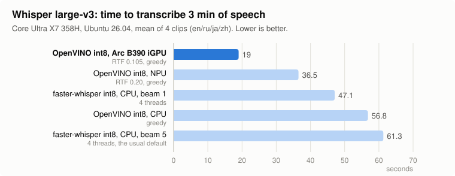
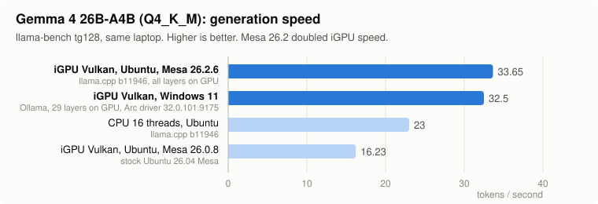
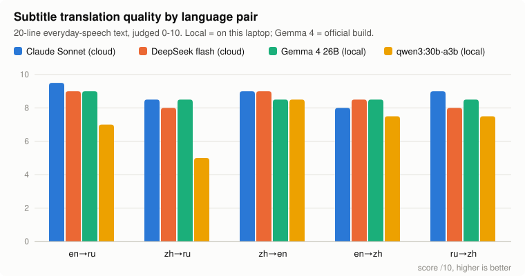

# Локальный ИИ на Intel Arc B390 (Panther Lake): замеры Whisper, Qwen3-ASR, Gemma 4 и Qwen3 на встроенной видеокарте, NPU и CPU

[English](README.md) · **Русский**

Скорость и точность локального распознавания речи (ASR) и перевода с помощью LLM на тонком ноутбуке с **Intel Core Ultra X7 358H** (Panther Lake) и встроенной видеокартой **Intel Arc B390**, 32 ГБ ОЗУ, без дискретной видеокарты. Среды: **OpenVINO GenAI**, **llama.cpp (Vulkan)**, **Ollama**, **faster-whisper**. Система: **Ubuntu 26.04** с Mesa 26.0.8 и 26.2.6, для сравнения **Windows 11**. Облачные сервисы распознавания и перевода даны как точка отсчёта.

Цифры получены при создании программы, которая пачкой переводит иностранные видео в субтитры (ja/zh/en/ru). Замеры шли с 27 октября по 19 ноября 2026 года.

## Главное

| Вывод | Цифры |
|---|---|
| Whisper large-v3 на встроенной Arc B390 (OpenVINO int8) против faster-whisper на CPU | **в 3,2 раза быстрее**: 19 с против 61 с на 3 минуты звука (RTF 0,105 против 0,34) |
| Whisper large-v3 на NPU (OpenVINO) | работает, текст тот же, **вдвое медленнее видеокарты** (RTF 0,20), грузит 15 % одного ядра, нужно ~7,5 ГБ ОЗУ, первая компиляция 15 минут |
| Qwen3-ASR 1.7B на видеокарте (llama.cpp Vulkan) | **в 1,6 раза быстрее** CPU, текст совпадает |
| Генерация Gemma 4 26B-A4B на видеокарте, **Mesa 26.0.8 → 26.2.6** | **16,2 → 33,7 ток/с (в 2,1 раза)**; теперь в 1,6 раза быстрее CPU (20,7–23 ток/с) |
| Перевод субтитров Gemma 4 26B через Ollama, видеокарта против CPU | **0,48 с/строку против 2,2 с/строку** (103 строки, ja→ru) |
| Windows 11 против Ubuntu на том же ноутбуке | Whisper на видеокарте и LLM на CPU одинаковы; LLM на видеокарте была вдвое быстрее в Windows **до Mesa 26.2**, теперь ток/с те же (Ubuntu на 10–20 % быстрее на строку: все слои помещаются на GPU) |
| Лучшая локальная модель перевода (5 языковых пар) | **Gemma 4 26B-A4B**: официальная сборка в среднем 8,6 из 10 при 0,74 с/строку на видеокарте, рядом с Claude Sonnet (8–9,5) и DeepSeek (8–9) |
| Официальная Gemma 4 против сборки сообщества «abliterated» | официальная не хуже (8,6 против 8,3) и на ~9 % быстрее на строку; на обычном тексте отказов нет ни у одной |
| Лучшее локальное распознавание по языкам | ja: Whisper large-v3 · zh, en: Qwen3-ASR 1.7B · ru: GigaAM v3 (шум) / Whisper large-v3 (чистая речь) |

## Содержание

- [Ноутбук и программы](#ноутбук-и-программы)
- [1. Распознавание речи на видеокарте, NPU и CPU](#1-распознавание-речи-на-видеокарте-npu-и-cpu)
- [2. LLM на Arc B390: обновите Mesa](#2-llm-на-arc-b390-обновите-mesa)
- [3. Windows 11 против Ubuntu 26.04](#3-windows-11-против-ubuntu-2604)
- [4. Распознавание и LLM одновременно](#4-распознавание-и-llm-одновременно)
- [5. Точность распознавания: локально и в облаке, по языкам](#5-точность-распознавания-локально-и-в-облаке-по-языкам)
- [6. Качество перевода по языковым парам](#6-качество-перевода-по-языковым-парам)
- [Как повторить](#как-повторить)
- [Методика и оговорки](#методика-и-оговорки)
- [Файлы с данными](#файлы-с-данными)

## Ноутбук и программы

| | |
|---|---|
| Ноутбук | Lenovo ThinkBook 16+ G8+ (2026) |
| Процессор | Intel Core Ultra X7 358H (Panther Lake), 16 ядер |
| Видеокарта | Intel Arc B390 (Xe3), встроенная, память общая с системой |
| NPU | Intel AI Boost |
| ОЗУ | 32 ГБ (Vulkan отдаёт видеокарте до ~23 ГБ, OpenVINO до ~28 ГБ) |
| Linux | Ubuntu 26.04, ядро 7.0, Mesa 26.0.8 (штатная) и 26.2.6 (PPA kisak), драйвер NPU Intel 1.38.0 |
| Windows | Windows 11, драйвер Arc 32.0.101.9175 |
| Среды | OpenVINO / OpenVINO GenAI 2026.4.1, llama.cpp b11946 (сборки CPU и Vulkan), Ollama, faster-whisper (CTranslate2 int8) |
| Питание | всегда от сети; профиль питания «performance», если не сказано иное |

## 1. Распознавание речи на видеокарте, NPU и CPU

Четыре клипа по 3 минуты (en, ru, ja, zh) из открытых выступлений TEDx/TED. Время дано в среднем на клип.

<picture>
  <source media="(prefers-color-scheme: dark)" srcset="charts/whisper-devices-dark.svg">
  
</picture>

| Модель | Среда | Устройство | Время на 180 с | RTF | Ускорение |
|---|---|---|---:|---:|---:|
| Whisper large-v3 int8, beam 5 | faster-whisper | CPU, 4 потока | 61,3 с | 0,34 | 1× |
| Whisper large-v3 int8, beam 1 | faster-whisper | CPU, 4 потока | 47,1 с | 0,26 | 1,3× |
| Whisper large-v3 int8 | OpenVINO GenAI | CPU | 56,8 с | 0,32 | 1,1× |
| **Whisper large-v3 int8** | **OpenVINO GenAI** | **видеокарта Arc B390** | **19,0 с** | **0,105** | **3,2×** |
| Whisper large-v3 int8 | OpenVINO GenAI | NPU | 36,5 с | 0,20 | 1,7× |
| Qwen3-ASR 1.7B Q8_0 | llama.cpp | CPU, 8 потоков | 53,3 с | 0,30 | — |
| **Qwen3-ASR 1.7B Q8_0** | **llama.cpp Vulkan** | **видеокарта Arc B390** | **33,4 с** | **0,185** | **1,6× к своему CPU** |

- Точность на видеокарте не меняется: OpenVINO на GPU и на CPU даёт тот же текст. Whisper в OpenVINO умеет только жадный поиск (beam search на встроенной видеокарте в OpenVINO GenAI 2026.4 всё ещё сломан). На английском это стоит около 2 пунктов WER (8,0 против 5,7), на русском и японском ничего.
- На гибридном процессоре больше потоков сделали faster-whisper медленнее: 4 потока (по умолчанию в CTranslate2) обогнали 16 потоков в 1,3–2,8 раза. Qwen3-ASR лучше всего работает на 8 потоках.
- GigaAM v3 (русский) и так работает на CPU с RTF 0,05–0,18, видеокарта ему не нужна.
- После обновления Mesa до 26.2.6 (раздел 2) Whisper на видеокарте стал быстрее на ~7 %, Qwen3-ASR на Vulkan на ~30 %, текст тот же.

### NPU против видеокарты (Whisper large-v3, OpenVINO, клипы по 180 с)

| | NPU | Видеокарта |
|---|---:|---:|
| Время на клип | 35–39 с (RTF 0,20) | 18–21 с (RTF 0,10) |
| Нагрузка на CPU | 15–17 % одного ядра | ~100 % одного ядра |
| Занято ОЗУ | ~7,5 ГБ | ~3,5 ГБ |
| Мощность процессора | ~19,5 Вт | ~29 Вт |
| Энергия на клип сверх простоя | 380–410 Дж | 370–430 Дж |
| Первая загрузка | компиляция 910 с, пик 10,3 ГБ (дальше ~4 с из кэша) | 4,4 с |
| Точность | тот же текст (ru/en совпадают, ja/zh отличаются на несколько знаков) | |

NPU тише и оставляет свободными CPU и видеокарту, но он вдвое медленнее, требует вдвое больше памяти и не экономит энергию на клип. При работе от сети видеокарта лучше. Qwen3-ASR, GigaAM и LLM на 26–30B на NPU не запускаются.

## 2. LLM на Arc B390: обновите Mesa

Со штатной Mesa из Ubuntu 26.04 (26.0.8) видеокарта читала промпт в 6 раз быстрее CPU, но писала ответ на 30 % медленнее. Mesa 26.2.6 это исправила: генерация ускорилась вдвое.

<picture>
  <source media="(prefers-color-scheme: dark)" srcset="charts/gemma-mesa-dark.svg">
  
</picture>

llama-bench (llama.cpp b11946), файлы GGUF Q4_K_M, все слои на видеокарте (`-ngl 99 -fa 1`):

| Модель | Бэкенд | Mesa | Чтение pp512, ток/с | Генерация tg128, ток/с |
|---|---|---|---:|---:|
| Gemma 4 26B-A4B QAT | CPU, 16 потоков | — | 103,6–108,9 | 20,7–23,0 |
| Gemma 4 26B-A4B QAT | Vulkan, видеокарта | 26.0.8 | 687,8 | 16,2 |
| **Gemma 4 26B-A4B QAT** | **Vulkan, видеокарта** | **26.2.6** | **743,9** | **33,7** |
| Gemma 4 26B-A4B QAT | Vulkan, веса на CPU (`-ngl 0`) | 26.0.8 | 195,4 | 16,5 |
| Qwen3 30B-A3B | CPU, 16 потоков | — | 113,8 | 27,8 |
| Qwen3 30B-A3B | Vulkan, видеокарта | 26.0.8 | 687,9 | 22,6 |

Перевод файла субтитров из 103 строк (ja→ru) моделью Gemma 4 26B через Ollama, пачками по 25 строк:

| Где работает Gemma | Время | На строку |
|---|---:|---:|
| **Видеокарта** (Ollama с Vulkan, Mesa 26.2.6, 31 из 31 слоя на GPU) | **49 с** | **0,48 с** |
| CPU (Ollama, 16 потоков) | 228 с | 2,2 с (2 пачки из 5 пришлось повторить; в чистых прогонах ~1,3 с/строку) |

Заметки:
- Ollama использует встроенную видеокарту Intel только с `OLLAMA_VULKAN=1` и `OLLAMA_IGPU_ENABLE=1`.
- Деление слоёв («веса на CPU, чтение на GPU») оказалось хуже обоих чистых вариантов.
- Бэкенд OpenVINO в llama.cpp исчерпал память при загрузке модели на 16 ГБ: для моделей 26B на 32 ГБ он не годится.
- У встроенной видеокарты нет своей памяти. Одна LLM на 16–18 ГБ и одна модель распознавания (2–3 ГБ) помещаются вместе, две большие LLM нет.
- После того как Ollama выгрузила Gemma с видеокарты, 11–16 ГБ ОЗУ остались заняты вне всех процессов (видимо, пул драйвера xe). Перезапуск Ollama их не освободил, а `sync && echo 3 | sudo tee /proc/sys/vm/drop_caches` освободил. Пока память была занята, Vulkan видел только ~10 ГБ, и следующая модель загрузилась на 20 % на CPU и на 80 % на GPU, то есть медленнее.

## 3. Windows 11 против Ubuntu 26.04

Тот же ноутбук (две системы), то же японское видео на 5,5 минуты, от сети.

| Тест | Windows 11 | Ubuntu 26.04 | Итог |
|---|---:|---:|---|
| Whisper large-v3 int8, OpenVINO, видеокарта | в 12,8 раза быстрее реального времени (9,6 с таймкодами слов) | ~9,5 (с таймкодами слов) | одинаково |
| faster-whisper large-v3 int8, beam 5, CPU 16 потоков | 1,08 мин на минуту звука | 0,66 мин на минуту звука | Ubuntu в 1,6 раза быстрее (Windows был в режиме «Сбалансированный») |
| Gemma 4 26B, Ollama, CPU, генерация | 21,8 ток/с | 23,0 ток/с | одинаково |
| Gemma 4 26B, видеокарта Vulkan, генерация | 32,5 ток/с (Ollama, 29 слоёв на GPU; все слои не влезли в память) | 16,2 ток/с с Mesa 26.0.8 → **33,7 ток/с с Mesa 26.2.6** | было вдвое в пользу Windows, теперь поровну |

Единственная разница между системами была в Vulkan-драйвере Linux, и свежая Mesa её убрала.

Перепроверка 20 ноября 2026 года на обеих сборках Gemma 4, те же запросы по 20 строк (раздел 6), Ollama с Vulkan:

| Gemma 4 26B-A4B | Ubuntu, с/строку | Windows, с/строку | Ubuntu, ток/с | Windows, ток/с |
|---|---:|---:|---:|---:|
| официальная (`gemma4:26b`) | 0,74 | 0,91 (0,82 без первого запроса) | 32,4 | 32,2 |
| сборка abliterated | 0,81 | 0,97 (0,90 без первого запроса) | 30,7 | 29,3 |

- Ubuntu: Ollama 0.40.11, Mesa 26.2.6, 31 из 31 слоя на GPU. Windows: Ollama 0.40.16, 30 из 31 слоя на GPU (все 31 не влезли в Vulkan-кучу на 18 ГБ).
- Скорость генерации теперь одинаковая. Windows на 10–20 % медленнее на строку: один слой остаётся на CPU, а первый запрос после загрузки идёт 29–37 с вместо ~16 с. Разброс между прогонами в Windows (0,84–0,97 с/строку на одной модели) больше, чем разница между моделями.
- В Windows с Vulkan официальная модель (у неё есть дополнительная черновая MTP-модель на 0,45 ГБ) не загружалась ни при каком `num_gpu`, пока для `ollama serve` не задали `LLAMA_ARG_NO_HOST=1`. Без этого часть весов, оставшаяся на CPU, кладётся в host-память Vulkan и съедает кучу на 18 ГБ.

## 4. Распознавание и LLM одновременно

CPU, видеокарта и NPU делят одну шину памяти и один бюджет питания. Замеры пар (Mesa 26.0.8):

| Что работает одновременно | Распознавание | LLM (Gemma 4 26B), чтение / генерация |
|---|---|---|
| Whisper OpenVINO на видеокарте + Gemma на CPU (12 потоков) | 20,9 с вместо 19,0 (−10 %) | 80 / 14,6 ток/с вместо 109 / 23,0 (−27 % / −37 %) |
| Gemma на видеокарте + faster-whisper на CPU (4 потока) | 62,7 с вместо 59,6 (−5 %) | 628 / 14,4 ток/с вместо 688 / 16,2 (−9 % / −11 %) |

Сильнее всего от соседа страдает LLM на CPU. Если переводить видео N, пока распознаётся видео N+1, держите LLM на видеокарте.

## 5. Точность распознавания: локально и в облаке, по языкам

Процент ошибок (CER для японского и китайского, WER для русского и английского). Меньше лучше.
Колонки: **FLEURS** (чтение вслух, ~10 минут на язык), **выступление** (3 минуты TEDx с ручными субтитрами), **интервью** (3 минуты разговора двух людей), **шум** (3 минуты ток-шоу с музыкой и смехом). RTF локальных моделей указан для CPU.

### Японский (CER %)

| Модель | Тип | FLEURS | Выступление | RTF |
|---|---|---:|---:|---:|
| ElevenLabs Scribe v2 | облако | **4,0** | 5,2 | 0,09 |
| gpt-4o-mini-transcribe | облако | 5,2 | **4,7** | 0,06 |
| gpt-4o-transcribe | облако | 4,9 | 5,4 | 0,08 |
| Gemini 3.5 Transcribe | облако | 4,3 | 5,4 | 1,07 |
| whisper-1 | облако | 7,8 | 5,1 | 0,19 |
| **Whisper large-v3** | локально | 6,4 | 5,9 | 0,88 |
| Qwen3-ASR 1.7B | локально | 7,4 | 6,6 | 0,38 |
| Qwen3-ASR 0.6B | локально | 11,6 | 6,3 | 0,23 |

### Китайский (CER %)

| Модель | Тип | FLEURS | Выступление | Интервью* | RTF |
|---|---|---:|---:|---:|---:|
| ElevenLabs Scribe v2 | облако | 4,0 | 8,6 | **1,7*** | 0,09 |
| Gemini 3.5 Transcribe | облако | **3,2** | 7,9 | 4,1 | 0,11 |
| gpt-4o-mini-transcribe | облако | 4,0 | **7,0** | 6,5 | 0,06 |
| gpt-4o-transcribe | облако | 3,9 | 7,5 | 6,5 | 0,09 |
| whisper-1 | облако | 4,2 | 8,8 | 8,4 | 0,14 |
| **Qwen3-ASR 1.7B** | локально | 3,4 | 10,8 | 2,7 | 0,36 |
| SenseVoice Small | локально | 5,3 | 10,7 | 3,4 | **0,06** |
| FireRedASR2-AED | локально | 5,2 | 12,0 | 4,1 | 0,92 |
| Whisper large-v3 | локально | 5,0 | 9,1 | 8,0 | 0,92 |

### Русский (WER %)

| Модель | Тип | FLEURS | Выступление | Интервью | Шум* | RTF |
|---|---|---:|---:|---:|---:|---:|
| gpt-4o-transcribe | облако | **2,9** | **2,7** | **11,8** | 27,4 | 0,09 |
| gpt-4o-mini-transcribe | облако | 4,5 | 3,7 | 13,6 | 21,7 | 0,07 |
| whisper-1 | облако | 5,3 | 2,7 | 14,6 | 21,0 | 0,13 |
| ElevenLabs Scribe v2 | облако | 3,8 | 5,6 | 16,9 | 0,0* | 0,09 |
| Gemini 3.5 Transcribe | облако | – | 4,8 | 17,4 | 19,7 | 0,04 |
| **GigaAM v3 e2e-RNNT** | локально | 6,5 | 5,1 | 20,2 | **13,3** | 0,18 |
| **Whisper large-v3** | локально | 5,5 | 2,7 | 17,2 | 17,9 | 1,12 |
| Qwen3-ASR 1.7B | локально | 6,5 | 6,4 | 14,8 | 17,9 | 0,48 |
| Parakeet TDT 0.6B v3 | локально | 9,3 | 9,3 | 22,6 | 28,1 | 0,22 |

gpt-4o-transcribe точнее всех на чистой русской речи, но на шумной теряет около пятой части текста.

### Английский (WER %)

| Модель | Тип | FLEURS | Выступление | Интервью | RTF |
|---|---|---:|---:|---:|---:|
| gpt-4o-mini-transcribe | облако | **5,8** | 5,3 | **6,2** | 0,08 |
| whisper-1 | облако | 6,9 | **4,9** | 7,6 | 0,14 |
| gpt-4o-transcribe | облако | 6,6 | 5,1 | 8,8 | 0,09 |
| Gemini 3.5 Transcribe | облако | – | 5,8 | 9,2 | 0,03 |
| ElevenLabs Scribe v2 | облако | 6,0 | 6,4 | 10,2 | 0,11 |
| **Qwen3-ASR 1.7B** | локально | 5,9 | 5,6 | 8,8 | 0,40 |
| Whisper large-v3 | локально | 8,1 | 5,1 | 9,3 | 1,32 |
| Parakeet TDT 0.6B v3 | локально | 12,1 | 8,3 | 18,0 | 0,25 |

\* У китайского «интервью» и русского «шума» нет ручных субтитров. Эталон собран из текста Scribe v2 и исправлен там, где другие модели с ним расходились, поэтому Scribe в этих колонках выглядит лучше, чем есть.

Внимание: OpenAI объявила, что gpt-4o-transcribe, gpt-4o-mini-transcribe и whisper-1 отключат 26 февраля 2027 года.

## 6. Качество перевода по языковым парам

Обычный разговорный текст на 20 строк (влог о путешествии: имена, еда, разговорные обороты; [исходник](test-texts/travel_vlog_en.md)), переведённый построчно как субтитры, пачками. Каждый перевод оценён по 10-балльной шкале против эталона: смысл, имена, лицо и род говорящего, тон, а для китайского ещё упрощённые иероглифы и полноширинная пунктуация.

<picture>
  <source media="(prefers-color-scheme: dark)" srcset="charts/translation-quality-dark.svg">
  
</picture>

| Модель | Тип | en→ru | zh→ru | zh→en | en→zh | ru→zh | с/строку |
|---|---|---:|---:|---:|---:|---:|---:|
| Claude Sonnet (через claude CLI) | облако | **9,5** | **8,5** | **9** | 8 | **9** | 0,5 |
| DeepSeek deepseek-flash | облако | 9 | 8 | **9** | **8,5** | 8 | **0,4** |
| DeepSeek deepseek-v4-pro | облако | 9 | 8 | 8,5 | 8 | 8 | 1,2 |
| **Gemma 4 26B-A4B, официальная** (`gemma4:26b`) ² | локально | 9 | **8,5** | 8,5 | **8,5** | 8,5 | 0,74 (видеокарта) |
| Gemma 4 26B-A4B QAT, сборка abliterated ¹ | локально | 9 | 8 | 8,5 | 8 | 8,5 | 8,1 (CPU) / 0,81 (видеокарта) |
| Qwen3.5 35B-A3B ¹ | локально | 8,5 | 7,5 | 8 | 8 | 7,5 | 5,4 |
| qwen3:30b-a3b | локально | 7 | 5 | 8,5 | 7,5 | 7,5 | 5,1 |
| Qwen3 30B-A3B instruct-2507 ¹ | локально | 6,5 | 5 | 8 | 7 | 7,5 | 5,4 |
| qwen3:14b | локально | 5,5 | 4 | 8 | 8 | 7,5 | 18,4 |
| Hunyuan-MT 1.5 7B ¹ | локально | – | 6 | 7,5 | 7 | 6,5 | 26,8 |

¹ Сборки сообщества «abliterated» из Ollama (`huihui_ai/...`): модели с вырезанным механизмом отказов. Локальная скорость дана для Ollama на CPU, 16 потоков; цифры для видеокарты: Ollama с Vulkan и Mesa 26.2.6.
² Оценена отдельным прогоном 20 ноября 2026 года (см. ниже).

Что видно:
- **Gemma 4 26B-A4B лучшая локальная модель во всех парах** и почти догоняет облачные. Официальная сборка не хуже сборки abliterated. Qwen3 30B и Hunyuan-MT слабы в паре китайский→русский (≈5–6): путают имена, оставляют иероглифы в русском тексте, переводят «хого» дословно.
- DeepSeek flash почти бесплатен (обе модели DeepSeek за весь тест обошлись примерно в $0,01) и здесь не хуже Sonnet.
- Типичные ошибки у всех: имена (Аня → 阿尼亚/安娜 вместо 安雅), неверный род говорящего в русском, полуширинная пунктуация в китайском.
- Hunyuan-MT 7B не держит формат JSON для пачек, поэтому пачки распадаются до одной строки (27 с/строку).

### Официальная Gemma 4 против сборки abliterated

Тот же текст на 20 строк, обе модели Q4_K_M, все слои на видеокарте (Ubuntu, Mesa 26.2.6, Ollama 0.40.11), по одному прогону при температуре 0,2:

| Пара | Abliterated | Официальная `gemma4:26b` | с/строку, abliterated / официальная | Отказы |
|---|---:|---:|---:|---:|
| en→ru | 9 | 9 | 0,85 / 0,80 | 0 / 0 |
| zh→ru | 7,5 | 8,5 | 0,85 / 0,85 | 0 / 0 |
| zh→en | 8,5 | 8,5 | 0,85 / 0,70 | 0 / 0 |
| en→zh | 8 | 8,5 | 0,75 / 0,70 | 0 / 0 |
| ru→zh | 8,5 | 8,5 | 0,75 / 0,65 | 0 / 0 |
| **Среднее** | **8,3** | **8,6** | **0,81 / 0,74** | **0 / 0** |

- На обычном тексте официальная модель не хуже и примерно на 9 % быстрее на строку (32,4 против 30,7 ток/с). В официальном пакете Ollama есть черновая MTP-модель на 0,46 ГБ для спекулятивного декодирования.
- Удаление отказов не ухудшило качество перевода заметно, но и не помогло: ни одна модель здесь ни от чего не отказалась.
- ±0,5 в одной паре это шум: повторный прогон той же модели менял 7–10 строк из 20. Сборка abliterated получила 8 за zh→ru в прежнем прогоне на CPU и 7,5 здесь.

## Как повторить

Команды для Ubuntu 26.04, если не сказано иное. Модели: GGUF с Hugging Face или из Ollama, OpenVINO IR из организации `OpenVINO/` на Hugging Face.

**Свежая Mesa (ускорение LLM на видеокарте вдвое)**

```bash
sudo add-apt-repository ppa:kisak/kisak-mesa
sudo apt update && sudo apt full-upgrade
vulkaninfo --summary | grep -i driverInfo   # должно быть Mesa 26.2.x или новее
```

**Скорость LLM через llama-bench (llama.cpp, сборка Vulkan)**

```bash
# видеокарта, все слои, flash attention
./llama-bench -m <model>.gguf -ngl 99 -fa 1 -p 512 -n 128
# только CPU
./llama-bench -m <model>.gguf -ngl 0 -t 16 -p 512 -n 128
```

**Ollama на встроенной видеокарте Intel**

```bash
OLLAMA_VULKAN=1 OLLAMA_IGPU_ENABLE=1 ollama serve
# Windows PowerShell: $env:OLLAMA_VULKAN="1"; ollama serve
```

**Whisper large-v3 на видеокарте или NPU через OpenVINO GenAI**

```bash
python3 -m venv ~/.venvs/ov-whisper && . ~/.venvs/ov-whisper/bin/activate
pip install openvino-genai==2026.4.1 librosa huggingface_hub
hf download OpenVINO/whisper-large-v3-int8-ov --local-dir whisper-large-v3-int8-ov
```

```python
import time, librosa, openvino_genai as ov_genai

pipe = ov_genai.WhisperPipeline("whisper-large-v3-int8-ov", "GPU")  # или "NPU", "CPU"
audio, _ = librosa.load("clip.wav", sr=16000)
t = time.time()
result = pipe.generate(audio.tolist(), language="<|ja|>", task="transcribe",
                       return_timestamps=True, word_timestamps=True)
print(f"{time.time() - t:.1f} s")
print(result.texts[0])
```

Для NPU поставьте [linux-npu-driver](https://github.com/intel/linux-npu-driver/releases) от Intel (в 1.38.0 есть пакеты для Ubuntu 26.04) и задайте постоянный кэш компиляции (`CACHE_DIR`), иначе каждый запуск будет компилировать модель 15 минут.

**Базовый faster-whisper на CPU**

```python
from faster_whisper import WhisperModel
model = WhisperModel("large-v3", device="cpu", compute_type="int8", cpu_threads=4)
segments, _ = model.transcribe("clip.wav", language="ja", beam_size=5, word_timestamps=True)
print(" ".join(s.text for s in segments))
```

**Qwen3-ASR на видеокарте:** `llama-server` из llama.cpp b11946 (сборка Vulkan) с GGUF Qwen3-ASR 1.7B Q8_0 и его аудиопроектором, `-ngl 99`; на этом CPU в 5–10 раз быстрее, чем через transformers.

## Методика и оговорки

- **Процент ошибок.** CER для ja/zh, WER для ru/en. Обе стороны нормализованы: NFKC, нижний регистр, ё→е, числа записаны одинаково (цифрами для ja/zh, словами для ru/en), без пунктуации и [пометок], китайский приведён к упрощённым иероглифам. FLEURS считается по всем фразам вместе.
- **Скорость.** RTF = время работы ÷ длина звука. Все цифры с одного ноутбука, от сети, обычно в профиле «performance». На настольных ПК и других ноутбуках с Panther Lake будет иначе.
- **Точность в разделе 1** (таблица скорости) посчитана до того, как добавили нормализацию чисел, поэтому немного отличается от раздела 5. Модели сравнивайте по разделу 5.
- **Оценки перевода** сделаны по одному короткому тексту (20 строк на пару) LLM-судьёй (Claude) по письменным критериям. Эталоны тоже написаны с помощью Claude, поэтому Claude может быть слегка завышен. Разницу меньше 1 балла считайте шумом.
- **Облачные модели** проверены в октябре 2026 года через публичные API; версии меняются без предупреждения.
- **Не публикуются:** аудиоклипы (они из чужих видео, ниже только ссылки на источники) и исходный код программы.

Источники клипов (отрывки по 3 минуты): Ёсиэ Комуро, TEDxTokyo (ja, выступление) · May Chen, TEDxTaipei (zh, выступление) · 鲁豫有约, гостья G.E.M. (zh, интервью) · Василий Ключарев, TEDxSadovoeRing (ru, выступление) · интервью GQ Russia (ru, интервью) · «Вечерний Ургант» (ru, шум) · Johann Hari, TED (en, выступление) · WIRED Autocomplete Interview (en, интервью) · тестовые наборы FLEURS.

## Файлы с данными

| Файл | Что внутри |
|---|---|
| [data/asr_accuracy.csv](data/asr_accuracy.csv) | Ошибки распознавания и RTF, все модели и языки |
| [data/asr_speed_devices.csv](data/asr_speed_devices.csv) | Whisper и Qwen3-ASR на CPU, видеокарте, NPU |
| [data/npu_vs_gpu.csv](data/npu_vs_gpu.csv) | NPU против видеокарты: время, нагрузка CPU, ОЗУ, мощность, энергия |
| [data/llm_speed.csv](data/llm_speed.csv) | Скорость чтения и генерации LLM, версии Mesa, Windows |
| [data/translation_quality.csv](data/translation_quality.csv) | Оценки перевода по парам и скорость |
| [data/gemma_official_vs_abliterated.csv](data/gemma_official_vs_abliterated.csv) | Официальная Gemma 4 против abliterated: оценки, скорость, Ubuntu и Windows |
| [test-texts/travel_vlog_en.md](test-texts/travel_vlog_en.md) | Тестовый текст для перевода |

## Лицензия

Тексты, таблицы, графики и данные: [CC BY 4.0](https://creativecommons.org/licenses/by/4.0/deed.ru). Ссылка: «borspeaker-lab, Local AI on Intel Arc B390 benchmarks, 2026».

Поправки и свои цифры для Panther Lake / Arc B390 присылайте в [Issues](../../issues).
